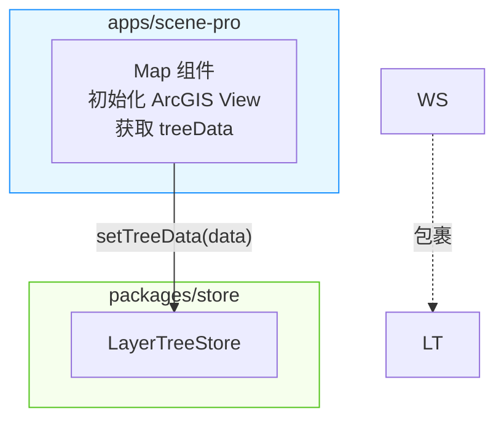
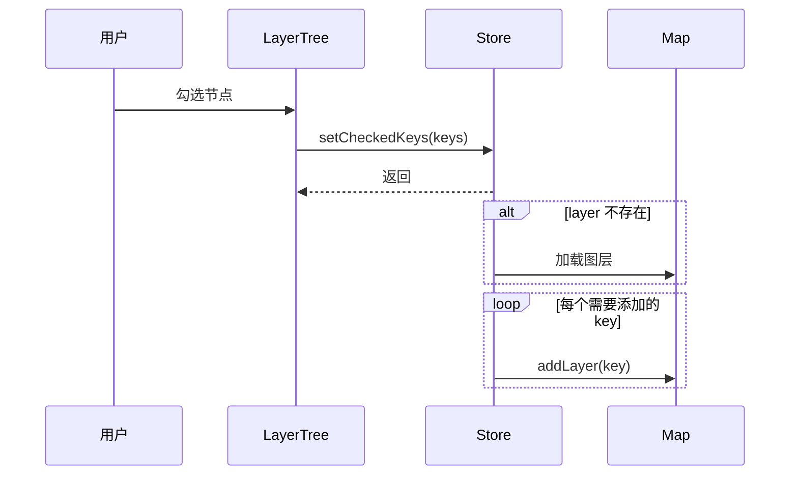

# 文档语域参考

`SKILL.md` 是流程，`style-dna.md` 是句子层的手册。**本文件专讲"写文档"和"写文章"不一样的地方。**

语料：`~/Documents/GitHub/chu/docs/` 19 篇（框架 Chu 的文档）。写**设计文档 / 约定与规范 / 决策记录**时必看。

## 目录

- [一、先确认你写的是哪一类](#一先确认你写的是哪一类)
- [二、决策叙事：作者最独特的一类文字](#二决策叙事作者最独特的一类文字)
- [三、规定语气：怎么让同事照着做](#三规定语气怎么让同事照着做)
- [四、设计文档怎么写](#四设计文档怎么写)
- [五、约定与规范怎么写](#五约定与规范怎么写)
- [六、目录树与架构图的画法](#六目录树与架构图的画法)
- [七、开头与结尾](#七开头与结尾)
- [八、文档 vs 博客：一张对照表](#八文档-vs-博客一张对照表)
- [九、常见跑偏与纠正](#九常见跑偏与纠正)

---

## 一、先确认你写的是哪一类

| 读者的问题 | 类型 | 语料样本 |
|---|---|---|
| "这东西为什么存在、怎么设计的？" | 设计文档 | `layerTree-layerControl`、`env`、`layout-menu`、`monorepo`、`theme`、`gis` |
| "我该怎么做才对？" | 约定与规范 | `layer-config`、`react-best-practices`、`access`、`routes`、`request` |
| "当初为什么选它？" | 决策记录 | `lint`、`data-flow`、`naming` |
| "怎么跑起来？" | 教程 | `quickstart` |
| "出了这个问题怎么办？" | FAQ / 踩坑 | `faq` |
| "有个东西在哪来着？" | 索引 / 速查 | `index`、`widgets`、`timing` |

**分类决定语气**：设计文档可以解释，规范必须命令，决策记录必须交代来龙去脉，索引只放链接。

---

## 二、决策叙事：作者最独特的一类文字

`philosophy/lint.md` 全文只有 6 行散文，却是全语料最能代表他的一篇：

> 本来想继续沿用umi的[lint规则](链接)，即[umi/lint](链接)。
>
> 但是umi/lint 不支持eslint9，也[没工夫升级](链接)。
>
> 中途使用过其他支持eslint9的热门开源配置：[xo](链接)和[@antfu/eslint-config](链接)。
>
> 最后使用的阿里的前端规约[eslint-config-ali](链接)，因为它文档依据写的很好。
>
> 并没有添加太多的配置，主要是忽略掉ArcGIS JS 的静态文件和Umi的运行文件，详见[eslint.config.js](链接)。

### 骨架

```
本来想 A（含一个指向 A 文档的链接）
但是 A 有毛病（具体是什么毛病，附 issue 链接更好）
中途使用过 B 和 C
最后使用的 D，因为它 E
并没有做太多额外的事，主要是 F，详见 [文件](链接)
```

### 四条规矩

1. **每一步都给"为什么被淘汰"**，不是笼统的"不适合"。`不支持eslint9` 是具体原因，`不太好用` 不是。
2. **理由可以说得很朴素**。`因为它文档依据写的很好` 就是完整理由，不用升华成"工程化程度高、社区活跃、可扩展性强"。
3. **一定要有链接**。提到一个库、一个 issue、一个配置文件，就把链接挂上去。读者要能自己去看。
4. **别审自己过去的决策**。他说 `本来想继续沿用umi的lint规则`，是陈述当时的想法，不追加"现在想想当时太天真了"。语气是平的。

### 情绪可以有，但只一句

> 但是umi/lint 不支持eslint9，也[没工夫升级](链接)。

`没工夫升级` 这种话，是决策记录里最好的一句。它真实、简短、不装。同类的还有：

> 幸好Umi提供了一些方式可以获取到routes配置和location。

> 政务网和内网，还出于手工拷贝部署的刀耕火种中。

**整篇一处，别多。**

---

## 三、规定语气：怎么让同事照着做

规范类文档的核心是**让读者知道该怎么做**。语料里的做法：

### 四种基本句式

| 场景 | 句式 | 原文 |
|---|---|---|
| 定默认 + 给出路 | `默认都……；无须……的，请设置 X` | ``默认都展示图例；无须展示的，请设置`legendEnabled: false`。`` |
| 定唯一做法 | `不使用 A，而是统一使用 B` | ``**不使用`.umirc.ts`，而是统一使用`config/config.js`**`` |
| 直接下命令 | `请设置 X` / `XXX使用 Y` | `声明图层，使用`useRef`` / `获取地图`view`，使用`useStore`` |
| 立约定 | `> 我们约定……` | `> 我们约定view的domId为"view"。` |

### 语气对照

| ❌ 不要写 | ✅ 写成 |
|---|---|
| 我们建议您使用 pnpm 来管理依赖 | 所以必须使用[pnpm](链接)。 |
| 推荐将图例关闭，可以提升性能 | 无须展示的，请设置`legendEnabled: false`。 |
| 最好把请求写在独立的 service 文件里 | 组件的请求尽量写在自己的`service.js`文件中，方便迁移。 |
| 请注意：务必不要使用 `.umirc.ts` | **不使用`.umirc.ts`，而是统一使用`config/config.js`** |
| 开发者可以根据自己的需要灵活配置 | 图层配置属性以[api文档](链接)为准，可以加自定义属性。 |

### 关键：`建议` 零出现

66 篇语料里 `建议` 出现 **0 次**，`推荐` 也几乎不用。他用的是：

- **默认 + 例外**：`默认都展示图例；无须展示的，请设置…`
- **尽量**：`组件的请求尽量写在自己的 service.js 文件中`
- **可以**：`可以加自定义属性`
- **必须**（散文里全语料 3 次，留给真正的硬要求）

`建议` 的问题是它把决定权推回给读者，而规范类文档的价值恰恰是**替读者做完决定**。

### 不解释为什么

> 默认都展示图例；无须展示的，请设置`legendEnabled: false`。

就这样，不说"因为图例有助于用户理解符号含义"。规范不需要论证，需要的是可执行。

**例外**：如果一个规定反直觉、或者新人一定会踩，补一个 `>` 引用块或一句原因就够：

> 文件加载完全会继续加载umi.js，所以在这里加载的js不支持异步。

### 两条总口诀

**一、解释技术选型，断言读者规则。**

为什么选 Zustand、为什么禁用 Umi 的默认布局，这些**要交代原因**（第三方限制 / 成本 / 学习成本 / 项目形态）。

但写给读者照做的规则**不给原因**。`默认都展示图例；无须展示的，请设置 legendEnabled: false。` 后面不接"因为图例有助于用户理解符号含义"。

**二、代价只算在被放弃的方案头上。**

博客里他会承认自己的方案有代价（`ramda的写法明显要更复杂一些。`），**文档里从不**。文档只列被淘汰方案的问题，自己选的方案只讲收益和残留（`现有代码无需改动。`）。

---

## 四、设计文档怎么写

### 骨架（`layerTree-layerControl.md`，975 行，最完整的样本）

```
# 目录树设计与图层加载

## 需求             ← 要支持哪些变化，一串并列条目
## 图层控制         ← 一句话说清核心动作
## 设计思路         ← 一段话讲清核心机制（可选：确实需要时才补图）
### 架构总览
### 用户勾选节点的数据流
### 初始化自动加载流程
## 实现过程         ← 按模块拆
### store
### lib
### widgets
## 高阶             ← 进阶用法
### app
## 附件             ← 完整代码 / 数据结构
## 多实例           ← 边界情况
### 何时需要传 `useStore`
### 自定义图层控制逻辑
## 后台接口字段对接
```

### 几个要点

**1. `## 需求` 用并列条目写"变化"，不用段落。**

> 目录树的功能是多变的，可能以下的功能都需要实现
> - 查询 [antd 示例](链接)
> - 懒加载 [antd示例](链接)
> - 拖拽 [antd示例](链接)
> - 默认勾选
> - 节点操作，如 缩放至、 属性表等
> - 联动，其他组件开关图层，同步给目录树

注意**第一行是一个不完整的句子**（`可能以下的功能都需要实现`），直接接列表。他没写成"以下是我们需要支持的功能："。这种不修饰是特征。

**2. `## 设计思路` 一句话讲完机制，然后交给图。**

> 通过中间件，把**视图**、**数据获取**和**图层控制**逻辑做区分。

一句话。核心机制说清楚就够了，细节在后面的实现里。**这里通常不需要图**，`layerTree` 那篇是全文唯一配了图的。

**3. `## 实现过程` 按模块名分节，每节 = 一句机制 + 一段代码。**

这是**唯一允许段落到 2 句**的地方：

> store 管理 `checkedKeys` 和 `treeData` 状态，通过 `subscribeWithSelector` 监听变更。`checkedKeys` 变更后委托给 `layerControl` 对象处理实际的图层加载/卸载，默认行为是单 key 单图层的增删。
>
> `createLayerTreeStore` 接受可选的 `layerControl` 参数，用于覆盖默认的图层控制逻辑（例如勾选一个 key 加载多个关联图层）。

第一句讲"它是什么"，第二句讲"它怎么变"。**两句话，超出就拆成两节。**

**4. 模块名做标题，不做"第一步"。** `### store` `### lib` `### widgets` `### app`。

**5. 附件放完整代码。** `## 附件` 下面不再解释，直接给。

### 设计文档的开场

先给一句**立场或定位**，再进入需求：

> Chu使用的地理引擎是[ArcGIS Maps SDK for JavaScript](链接)。它是一个十分优秀的地理引擎，功能强大。
>
> Chu对ArcGIS API进行了简单的处理，写在下面，提供给开发者做参考。

`提供给开发者做参考` 这种**读者定位句**很好用：一句话告诉读者"这篇是给谁看的、能拿到什么"。

---

## 五、约定与规范怎么写

`tutorial/layer-config.md` 是最干净的样本，全文 9 行散文：

```
# 图层约定

## 配置

图层配置属性以[api文档](链接)为准，可以加自定义属性。

## 创建图层

ArcGIS的服务，使用官方函数[fromArcGISServerUrl](链接)创建。

## 图例

默认都展示图例；无须展示的，请设置`legendEnabled: false`。

## 图层列表

默认都展示在图层列表；无须展示的，请设置`listMode：'hide'`。
```

### 要点

1. **标题就是这条规则管的东西**（配置 / 创建图层 / 图例 / 图层列表）。不是"规则一""规则二"。
2. **每条规则一句话**。真的就是一句。
3. **格式高度统一**：最后两条用了完全相同的句式（`默认都……；无须……的，请设置X`）。**规范文档里的重复句式是优点**，读者扫一眼就知道去哪找例外。
4. **配一个代码或默认值**，哪怕只是 `` `listMode：'hide'` ``。
5. 没有开场白，没有结尾。`# 图层约定` 下面直接第一个 `##`。

### `react-best-practices.md` 的另一种写法

规则极短，每条一行，按情境分组：

```
## React页面部分

与传统React无异

有结果展示的，比如列表，使用`useState`

有页面交互的，比如Input输入，使用`useState`

## 地图交互部分

获取地图`view`，使用`useStore`

声明`widget`或`widgetViewModel`，使用`useRef`

声明图层，使用`useRef`
```

句式是 **`{什么场景}，使用 {什么}`**。适合"什么情况用什么"这类速查型规范。

---

## 六、目录树与架构图的画法

### 目录树

```
Chu
├─ apps
│  ├─ map-pro
│  └─ scene-pro
│     ├─ .umirc.ts
│     └─ src
├─ packages
│  ├─ cli
│  └─ ui
└─ pnpm-workspace.yaml
```

**带注释的完整版**（`react-best-practices.md`），注释右对齐挂 `//`：

```
├── components                          // 微件内部的组件，比如一个微件可以拆分出-
│   └── MyComponent                     // 操作部分和结果部分
│   		├── index.(js|jsx)              // 子组件的结构递归
│   		└── index.less
├── withCustomComponent                 // 如果有高阶组件，和useHooks是平级
│   ├── index.(js|jsx)                  // 高阶组件的结构递归
│   └── index.less
├── images                              // 图片，一般是用在样式的图片
├── assets                              // 附件，一般是地图相关的资源，比如gltf
├── viewModel.js                        // 分析工具对应ViewModel
├── useCustomHooksA.js                  // 比如绘制useSketch
├── config.js                           // 配置文件，比如服务地址、表格列
├── index.(js|jsx)                      // 主文件
└── index.less                          // 样式文件
```

规则：

- 字符用 `├─` `└─` `│`，**注意他用的是单个 `─` 不是 `──`**（两个文件里两种都有，随大流用 `├─`）。
- 注释**说明这一项是什么/放什么**，不复述文件名。`index.less // 样式文件` 这种同义反复要避免，除非是陌生约定。
- 多个可选扩展名写成一个：`index.(js|jsx)`、`app.(js|jsx)`。
- 语言标 `plain` 或 `text`。
- **注释里可以带半句没写完的话**（`比如一个微件可以拆分出-`），但**这是笔误，你自己写的时候要写完**。

### 代码前的引导句

写文档时，**文件路径就是最好的引导句**：

> `packages/lib/src/core/layer/createLayer.js`：
>
> `LayerTree.jsx`：
>
> `apps/scene-pro/src/widgets/Map/index.js`：

比"下面是 createLayer 的实现代码："短，而且读者能直接定位。

路径后面可以跟一个**括号说明**，只在文件名看不出用途时才加：

> `packages/lib/src/core/layer/core.js`（图层增删查）：
>
> `packages/lib/src/core/layer/treeData.js`（树数据工具函数）：

**博客的引导句不通用**：`参数说明：`（博客 7 次）和 `如下：`（博客 8 次）在文档里**一次都没出现**。文档用 `示例代码：` / `示例核心代码：` / `样式示例：` / `如：`。

**28% 的文档引导句不以冒号结尾**（博客是"绝大多数以冒号结尾"）。文档里这些形式都合法：

| 形式 | 例子 |
|---|---|
| 短句，无标点 | `pnpm安装依赖` / `使用本地静态资源` / `设置`assetsPath`` / `记得忽略git` |
| 短句 + 句号 | ``当Map组件中`view`实例化之后才会加载路由组件。`` |
| 编号步骤 | ``3. 在config中配置`headScript` `` |
| 短句 + 逗号 | ``组件的请求尽量写在自己的`service.js`文件中，方便迁移。如，`` |
| **小节标题本身就是引导句** | `## 样式文件` 下面直接跟代码块 |

最后一种值得注意：**当代码块的内容不言自明时，标题可以直接充当引导句**，不用再补一句话。

### 架构图：mermaid 很少用，别默认上

**先把话说清楚：目录树是常画的，mermaid 是极少用的。** 用户本人确认过这一点。

语料里的实际情况：

| | 数量 | 分布 |
|---|---:|---|
| 目录树（`plain` 代码块） | 5 处 | 分布在 `monorepo`、`react-best-practices`、`quickstart` 等 3 篇以上 |
| mermaid 图 | 3 张 | **全部在 `layerTree-layerControl.md` 这一篇里** |

66 篇里只有 1 篇用了 mermaid。**所以默认不画图**：

- 讲机制，**一段话说清 + 代码**就够了，这是他 65/66 篇的做法。
- 真需要画结构时，**先想目录树**——大部分"架构"其实就是文件怎么摆。
- **只有在确实要表达"谁调用谁、数据怎么流动"这种关系时**才考虑 mermaid，而且一篇文档最多一张。

不要因为"设计文档应该有架构图"就画一张。语料里最长最完整的那篇设计文档有图，不代表设计文档都得有图。

### 万不得已要画时：mermaid 的写法

如果确实需要，按下面的约定写（全部来自 `layerTree-layerControl.md`）。

**架构总览用 `graph TB`**：

````

````

**数据流用 `sequenceDiagram`**：

````

````

约定：

- **节点 id 用英文标识符，标签用中文**。
- 换行用 `<br/>`：`Map["Map 组件<br/>初始化 ArcGIS View"]`。
- **subgraph 的标题写包路径**：`subgraph Store["packages/store"]`。
- 边标签带引号，内容是**真实的 API 调用或中文动词**：`-->|"setTreeData(data)"|`、`-->|"渲染"|`。HOC 包裹这类非数据流用虚线 `-.->`。
- 需要时加一行 `%% 中文注释`。
- 每个 subgraph 配一条 `style`：`style App fill:#e6f7ff,stroke:#1890ff`。配色取 antd 色板（蓝 / 绿 / 紫 / 红 / 灰）。
- 条件用 `alt`，循环用 `loop`，条件文字中英混排。

---

## 七、开头与结尾

### 开头

**文档不需要摘要段，`# 标题` 下面直接进第一个 `##`。**

| 篇目 | 开头 |
|---|---|
| `layer-config.md` | `# 图层约定` → `## 配置` |
| `lint.md` | `# 编码规范` → `本来想继续沿用umi的lint规则…` |
| `naming.md` | `# 名称由来` → `GIS + Umi 由来的框架，所以想叫GUmi，` |
| `gis.md` | `# 地理引擎` → `Chu使用的地理引擎是…` |
| `env.md` | `# 多环境部署` → `## 背景` |
| `request.md` | `# 请求` → `请求默认使用Umi的[request](链接)。` |
| `routes.md` | `# 路由` → `基于Umi的[路由](链接)，在`config/routes.js`中配置，如：` |

三种开场，按文档类型选：

1. **直接进内容**（规范类）：标题下面就是第一条规则。
2. **一句定位/来由**（设计类）：`请求默认使用Umi的request。` / `权限沿用Umi的access。`
3. **`## 背景`**（需要交代约束时）：`GIS项目除了互联网环境之后，还可能有政务网和内网环境。`

**最常见、也最好用的一种是「沿用来路」句式**，一句话说清这是从哪儿来的、改了什么：

```
模板：{X}沿用{Y}的[{Z}](链接)。
模板：{X}默认使用{Y}的[{Z}](链接)。
模板：基于{Y}的[{Z}](链接)，在`{文件}`中配置，如：
```

> 权限沿用Umi的[access](链接)。
> 请求默认使用Umi的[request](链接)。
> 基于Umi的[路由](链接)，在`config/routes.js`中配置，如：

比"本文介绍 Chu 的权限方案"有用得多：读者立刻知道**要不要重新学**。

### 结尾

**多数文档直接停在最后一个代码块或最后一条规则上，没有结尾。**

需要收口时，用 **`## 参考链接`** 列裸链接：

```
## 参考链接

https://developers.arcgis.com/javascript/latest/migrating-to-components/

https://developers.arcgis.com/javascript/latest/programming-patterns/
```

裸链接**单独占行，不写链接文字，不加标点**。这是他和博客一致的习惯。

---

## 八、文档 vs 博客：一张对照表

| 维度 | 技术文档 | 技术博客 |
|---|---|---|
| 开头 | `# 标题` 直接进第一个 `##` | `## 背景` 或一句现象 |
| frontmatter | 无 | Hexo 四字段 + `<!-- more -->` |
| 链接 | **行内链接为主** | 裸链接为主 |
| 段落上限 | 1 句；机制说明可到 2 句 | 1 句 |
| 语气 | 可以有规定语气（请/无须/必须） | 陈述为主 |
| 标题 | 模块名 / 规则名 | 结构槽位 / 问题名 |
| 代码引导句 | **文件路径** | 光杆名词 |
| 决策叙事 | 独立成篇 | 少 |
| 收尾 | 直接停，或 `## 参考链接` | 直接停 |
| 索引 | 要在 `index.md` 加一行链接 | 不用 |

**共同点远多于差异**：代码占八成、一句一段、短标题、无套话、无 `——`/`……`/感叹号。

---

## 九、常见跑偏与纠正

| 跑偏 | 症状 | 纠正 |
|---|---|---|
| **写成 README 腔** | "本模块提供了强大的功能，支持灵活的配置" | 删掉形容词，直接说它做什么。`store 管理 checkedKeys 和 treeData 状态。` |
| **规范里写"建议"** | "建议使用 pnpm" | 改成 `所以必须使用pnpm。` 或用"默认……；无须……的，请设置X" |
| **规范里论证** | 每条规则后面跟一段"因为…所以…" | 删。规则不需要论证，反直觉的补一个 `>` 引用块就够 |
| **决策记录不给出处** | "最后选了一个比较合适的方案" | 补上具体名字、链接、和被淘汰的具体原因 |
| **设计文档全是议论** | 三句话以上的段落解释设计哲学 | 拆成"一句话机制 + 代码"。机制说明最多 2 句 |
| **目录树没注释** | 一串光秃秃的文件名 | 关键项右对齐加 `//` 说明它是什么 |
| **模块标题写成步骤** | `## 第一部分` `## 第二步` | 用模块名：`### store` `### lib` `### widgets` |
| **留错别字** | 文件名/函数名拼错、漏字 | **通读校对**。这是硬要求，不是风格 |
